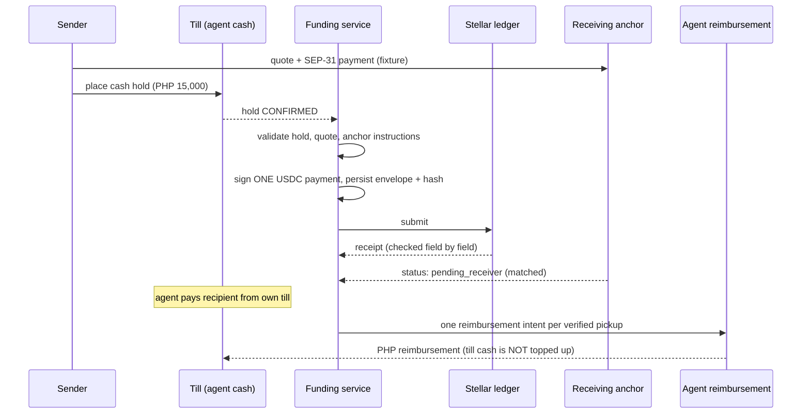

# CashDibs: crash-safe USDC funding for cash-pickup remittances

> A Stellar Testnet implementation of the money-movement core behind a Canada → Philippines cash-pickup remittance: the sender's USDC payment, the receiving anchor's matching, and the agent's off-chain reimbursement. Built for the Stellar Blockchain Innovation Challenge (Engineer 2 slice).

**Live proof:** a real 1 USDC payment made by this code on Stellar Testnet:
[`3718b772…b457430`](https://stellar.expert/explorer/testnet/tx/3718b772b8546ca7235233f8f95fe54324a0fc5fcc272abf0f281b09db457430)

## The problem

In a cash-pickup remittance, three parties move money at different times: the sender (CAD, in Canada), a receiving agent (PHP cash, in the Philippines) and the anchor that connects them. The hard part is not sending USDC. It is staying correct when things fail: a timeout after the payment was sent, an expired cash hold, a duplicate message, a lost response. A naive "retry on error" sends the money twice. A naive "mark failed on error" leaves cash handed out with no funding.

## How a transaction flows



## What is real and what is simulated

| Part | Status |
|---|---|
| USDC payment on Stellar Testnet (Circle's Testnet USDC) | **Real**, verifiable on stellar.expert |
| Receiving anchor, SEP-38 quote, "payment matched" status | **Simulated** fixture, marked `simulated: true`. An HTTP adapter for a real SEP-1/10/38/31 anchor exists but has never been run against one |
| PHP reimbursement to the agent | **Simulated** fixture |
| Cash hold, pickup verification, till | **Placeholders** in the demo; owned by the web-app half of the project |

This is a Testnet-only prototype. It is hard-wired to refuse any other network.

## The design decisions worth reading

1. **Persist before you submit.** The signed transaction and its hash are saved before the first network call. After a crash, the same bytes can be re-sent, which is safe because an identical transaction cannot pay twice.
2. **An error is not a failure.** Timeouts and even `tx_bad_seq` can mean "it already landed". Every submit error becomes *unknown*. A payment is only *failed* when the ledger says so, or when two checks after the transaction's deadline show it never landed.
3. **Verify the chain, not the response.** The on-chain payment is compared with the anchor's instructions (destination, asset, issuer, amount, memo). A mismatch goes to a human and is never auto-resolved.
4. **Ledger success is not "the anchor matched".** The anchor's status is tracked separately, and stale statuses never move it backwards.
5. **Hold before money.** USDC is sent only against a confirmed, unexpired cash hold whose amount equals the quote, and the payment's validity window is capped by both quote and hold expiry.
6. **Reimbursement can't create cash.** One durable intent per verified pickup, retried with the same reference, and the module has no inventory dependency. A test enforces it.
7. **No secrets or personal data in logs.** Keys, signed envelopes, tokens and KYC fields are redacted.

## Run it yourself

Needs Node.js 20+ and internet access. On Windows, if npm says scripts are disabled, run `Set-ExecutionPolicy -Scope CurrentUser RemoteSigned` once.

```bash
npm ci
npm test                  # 82 tests, no network needed

npm run cashdibs:setup    # creates two Testnet accounts, funds them, adds USDC trustlines
# manual: faucet.circle.com -> Stellar Testnet -> USDC -> paste the SENDER address (10 USDC)
npm run cashdibs:preflight    # expect PREFLIGHT OK
npm run cashdibs:demo         # sends 1 real USDC and prints an explorer link
```

Expected demo output:

```
Start                      on-hand PHP 40,000.00 | held PHP 0.00 | available PHP 40,000.00
After CONFIRMED cash hold  on-hand PHP 40,000.00 | held PHP 15,000.00 | available PHP 25,000.00
Funding: CONFIRMED  hash <64 hex characters>
Explorer: https://stellar.expert/explorer/testnet/tx/<hash>
Anchor (SIMULATED) status: pending_receiver; ready for pickup authorization: true
After verified pickup      on-hand PHP 25,000.00 | held PHP 0.00 | available PHP 25,000.00
Reimbursement (SIMULATED PHP): SETTLED PHP 15,000.00
After reimbursement        on-hand PHP 25,000.00 | held PHP 0.00 | available PHP 25,000.00
```

Run the demo twice: the second run prints the same hash and sends nothing.

Account secrets are stored in `.testnet/` (git-ignored). Never commit or share them.

## Layout

```
lib/cashdibs/
  funding/service.ts        prepare, persist, submit, reconcile (the core)
  reimbursement/service.ts  one intent per pickup, idempotent retries
  ports.ts                  interfaces the host app implements (hold gate, stores)
  sep31/{fixture,http}.ts   labeled fixture anchor; partner adapter (unverified)
  stellar/                  payment building, Horizon adapters, sender preflight
  stores/                   in-memory and JSON-file stores
scripts/                    setup, preflight, demo
tests/                      82 tests incl. crash, timeout, tamper and concurrency cases
docs/INTEGRATION-NOTES.md   what the host app must provide
```

## Testing

The tests use a fake ledger that can time out after landing, time out without landing, reject, fail on the ledger, or hide the transaction. I also broke three key rules on purpose (treat a submit error as failure, skip the hold check, change the reimbursement reference) and confirmed the suite fails each time.

## Known limits

- No real anchor has confirmed a payment; partner behavior is unverified. SEP-12 customer registration is not implemented.
- The per-account lock is in-process only. Several server instances would need a database lock.
- Persistence is in-memory or a JSON file; a database store is described in `docs/INTEGRATION-NOTES.md` but not built here.
- After a failed attempt there is deliberately no automatic retry; a new payout and quote are required.

## License

MIT
